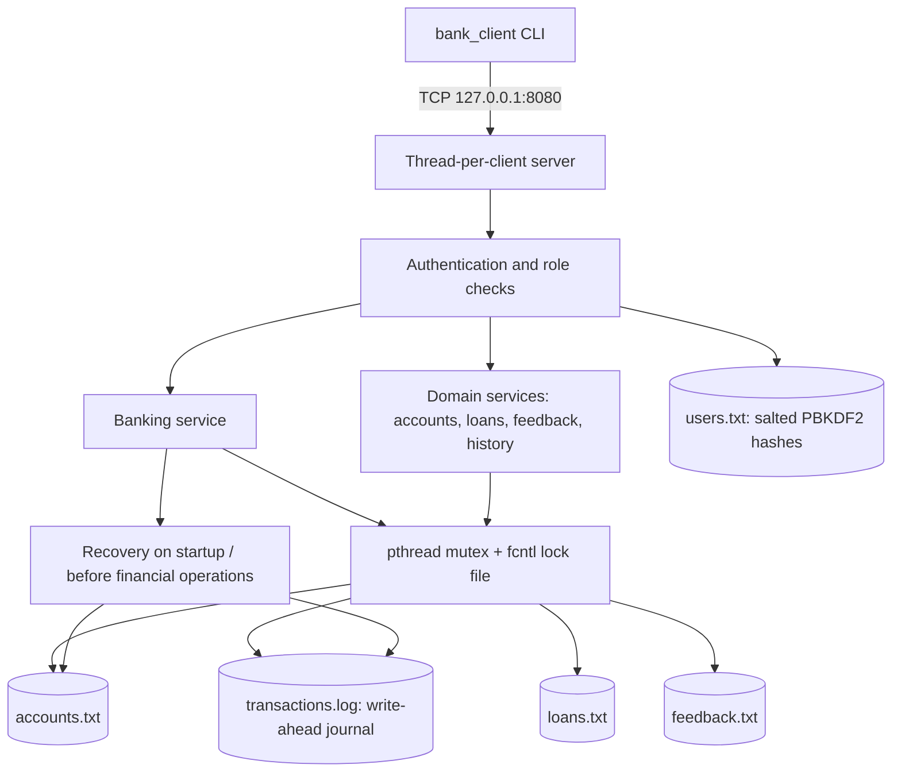
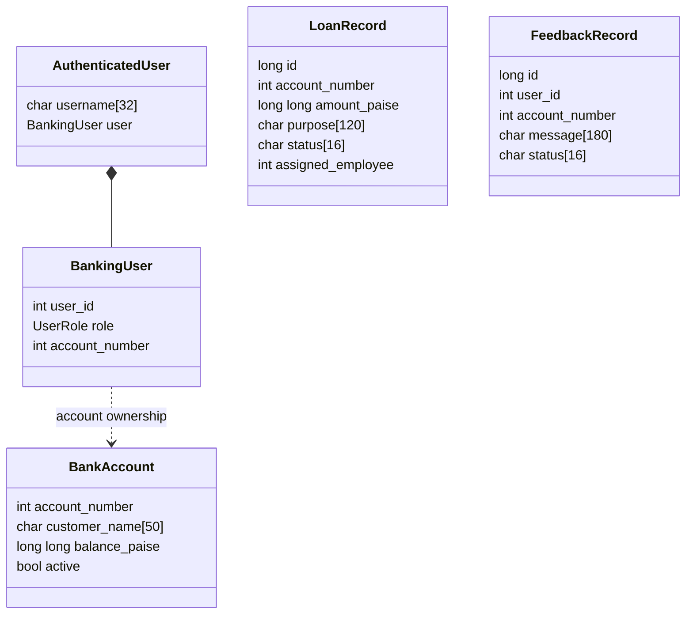

# Architecture and Design Blueprint

## High-level architecture

## Request lifecycle

1. Client connects to loopback TCP port 8080.
2. Server starts one detached pthread for the connection.
3. First line must be `LOGIN username password`; credentials are checked against `data/users.txt`.
4. The server applies role and customer-account ownership checks before executing a command.
5. Financial service operations acquire a process mutex and a stable `data/accounts.lock` advisory lock.
6. Account balances are loaded, validated, journaled, and atomically replaced. A recovery pass examines unfinished journal entries before further balance operations.
7. Server sends one line of response. `LOGOUT`/`EXIT` releases the in-memory session reservation.

## Module / class-style blueprint

This is C, so the design uses structs and modules rather than C++ classes.

## Role matrix

| Capability | Customer | Bank employee | Manager | Administrator |
|---|---:|---:|---:|---:|
| Own balance/deposit/withdraw/transfer | Yes | No | No | No |
| Apply/view own loan | Yes | — | — | — |
| Open customer account + customer login | No | Yes | No | No |
| Modify/close account | No | Yes | No | No |
| Process assigned/pending loan | No | Yes | No | No |
| Assign loan to employee | No | No | Yes | No |
| Activate/deactivate account | No | No | Yes | No |
| Review feedback | No | No | Yes | No |
| Add/manage users and roles | No | No | No | Yes |
| View account list | No | No | No | Yes |

## File formats

- `accounts.txt`: `account_number|customer_name|balance_paise|active(0/1)`
- `users.txt`: `username|salt_hex|hash_hex|user_id|role_number|account_number|active(0/1)`
- `loans.txt`: `loan_id|account_number|amount_paise|purpose|status|assigned_employee_user_id|created_by_user_id`
- `feedback.txt`: `feedback_id|user_id|account_number|message|OPEN`
- `transactions.log`: append-only PREPARED/TRANSFER_PREPARED/COMMITTED records.

## Synchronization and consistency

- `pthread_mutex_t` serializes financial operations among threads in one server process.
- `fcntl()` locks `data/accounts.lock`, which is a stable inode and therefore remains suitable while `accounts.txt` is replaced with `rename()`.
- Balance mutations use a write-ahead journal; account snapshots are written to a temporary file, `fsync()`ed and atomically renamed.
- Loan/account/feedback data are protected by the same lock for cooperating server operations. User-file mutation has a process-local mutex.
- **Scope/limitation:** this is a coursework prototype, not a production bank. Directory metadata durability, cross-file atomicity (e.g. account plus user creation), multi-process auth-session coordination, TLS, robust audit/event schemas, and exhaustive crash testing remain limitations. Do not claim formal ACID guarantees without further design and testing.
